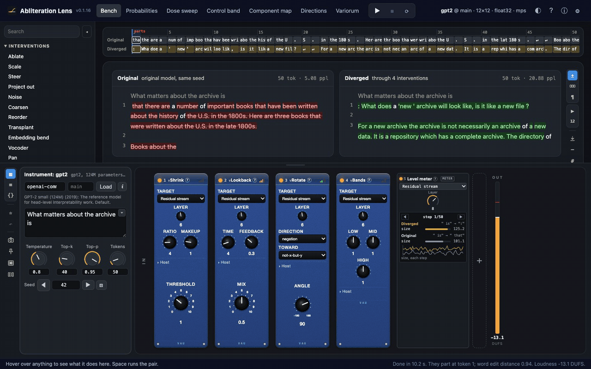
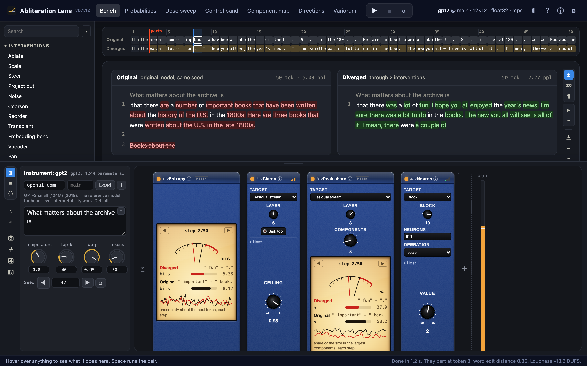
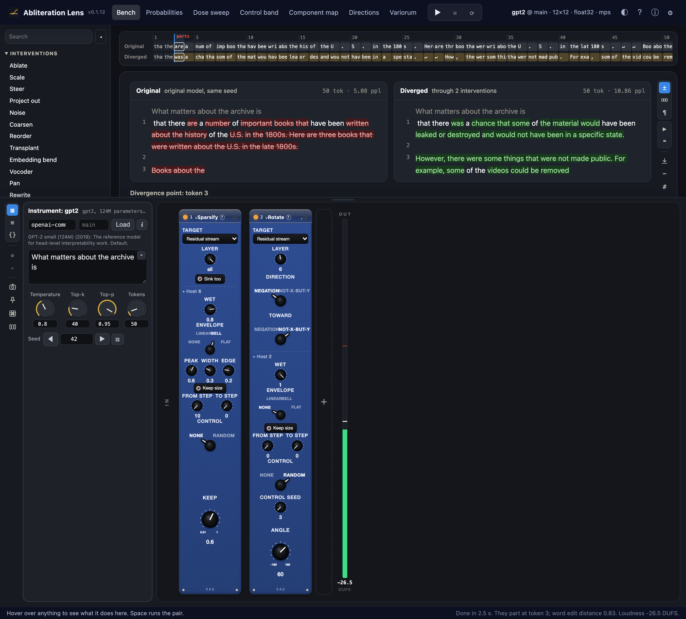

> Part of the [Vector Lab](https://github.com/vector-lab-tools). Vector methods for vector theory.
> [Overview and map](https://vector-lab-tools.github.io) · [FAQ](https://vector-lab-tools.github.io/faq.html) · [Org profile](https://github.com/vector-lab-tools)
>
> **Tier:** instrument. **Object:** a language model's forward pass, bent while it writes.
>
> **Units:** [Vector Abliteration Units](https://vector-lab-tools.github.io/vector-abliteration-units/) (VAU), whose first host this is ([site](https://vector-lab-tools.github.io/vector-abliteration-units/), [repository](https://github.com/vector-lab-tools/vector-abliteration-units)).
>
> **Site:** [vector-lab-tools.github.io/abliteration-lens](https://vector-lab-tools.github.io/abliteration-lens/): screenshots, how it works, recipes and rabbit holes; [What is abliteration?](https://vector-lab-tools.github.io/abliteration-lens/abliteration.html), with real runs set beside the texts they bend; and [the strips](https://vector-lab-tools.github.io/abliteration-lens/strips.html), each built-in strip with its help page.

<p align="center"></p>

<h1 align="center">Abliteration Lens</h1>
<p align="center">A mixing desk for a language model's forward pass<br>
<sub>A Vector Lab tool · alpha · GPL-3.0-or-later</sub></p>
<p align="center"><b><a href="https://vector-lab-tools.github.io/abliteration-lens/">Website: vector-lab-tools.github.io/abliteration-lens</a></b></p>

---

**Author:** David M. Berry
**Institution:** University of Sussex
**Version:** 0.1.19
**Status:** alpha
**Licence:** GPL-3.0-or-later
**Website:** https://vector-lab-tools.github.io/abliteration-lens/

Abliteration Lens loads an open-weight language model on your own machine and changes how its forward pass runs while it writes: ablating, scaling, steering, projecting out a direction, adding noise, coarsening, reordering, transplanting, and the effects and fitted edits that come as [Vector Abliteration Units](https://github.com/vector-lab-tools/vector-abliteration-units). Each change is a strip on a desk, with knobs, a fader, a power light and an activity meter. The diverged text is set beside the text the unchanged model writes from the same prompt and seed, and meters read the model as it goes: the logit lens, the stream's size and direction, attention, entropy, and the loudness of the change at the output. No accounts, no telemetry, no remote inference.

**On the word "abliteration".** In the interpretability literature, abliteration means removing a refusal direction from a model ([Arditi et al. 2024](https://arxiv.org/abs/2406.11717); [Labonne 2024](https://huggingface.co/blog/mlabonne/abliteration)). Abliteration Lens uses the word in an extended sense. Its default model, GPT-2 small, was never trained to refuse, and most of its strips (noise, block reordering, attention panning, the effects) remove no direction at all. It is an active divergence instrument ([Broad et al. 2021](https://arxiv.org/abs/2107.05599)), in which ablation is one strip among many.

<p align="center"></p>

## What it does

- **The chain.** Interventions are strips on a mixing desk, worked in order, each with an on/off light, its target (a head, an attention layer, an MLP, a block, or the residual stream at a layer) and its knobs. The same chain can be edited as text, one intervention per line, with `#` to bypass a line. The Code view shows the PyTorch hook code that will run.
- **Before and after.** The original and the diverged text side by side, seed-locked and streamed token by token, with a word-level diff, the token where the runs part and each run's five most probable tokens there, measures of distance and texture, and annotations on numbered lines in LLMbench's six types.
- **Probabilities.** Each text coloured by token probability under its own model and under the other: the diverged text under the original model, and the original text under the diverged model.
- **Dose sweep.** One knob swept across a range, the outputs stacked, with a marked breakdown point.
- **Control band.** The original reseeded n times, so that every distance is read against the model's own spread. A distance inside the band is reported as inside the band.
- **Sweep.** The selected strip, on its own, moved across every place its target can take (each head, block or layer), read teacher-forced on the last run's original text: loudness, mean KL and changed choices per place, as a grid; a click puts that target on the strip. All 144 heads of GPT-2 small take about three seconds.
- **Self-repair.** For each strip on its own, the loudness of its change carried straight to the output against the loudness of what the model does with it, in vB (the Hydra effect, McGrath et al. 2023): below 0 the later layers damp it, above 0 its effect runs through them. In each strip's activity box after a run, and as a Sweep measure.
- **Component map.** One intervention swept across every head or every layer, drawn as a grid against a probe: LLMbench's Grammar Probe constructions ("Not X but Y" and its relatives), counts of hedges, boosters, negation and evaluative words, distinct-2, repetition, surprisal under the original model.
- **Directions** from contrast sets (two shipped, as editable Markdown) or lists typed in, which is how a concept is ablated; from a single word, as the output layer writes it; from a sentence or passage, against the reference corpus; from where the model is about to write a word (the decision point, read before the word, as Arditi et al. read the refusal direction); by PCA of paired lists as well as by the difference of means, from pairs written from a template, or as sums of other directions (inspired by repeng); exported and imported as llama.cpp control vectors (GGUF); or imported from Vectorscope and Ablation Bench.
- **Vocoder and Pan.** The Vocoder imposes another prompt's band levels (bands of the stream's principal directions) on the text being written; Pan adds a bias by distance to the attention scores, toward the most recent tokens or toward the start.
- **Rewrite and Patch.** Rewrite edits one fact with a rank-one change to one MLP, inspired by ROME (Meng et al. 2022): on GPT-2 it makes "The Eiffel Tower is located in the city of" write " Rome" while other subjects stay as they were. Patch loads a saved set of weight changes for a run and puts the weights back after; a Rewrite can be saved as one.
- **Contrast and Chorus.** Two sampler bends that run extra passes at every step: Contrast samples from the diverged model's log probabilities less α times the original's (contrastive decoding), Chorus averages the probabilities of several detuned copies of the chain.
- **Token.** A strip that gives a word a zero input embedding wherever it occurs, or bans the model from writing it.
- **Workspace.** The dock at the foot of the window holds the Instrument (the model, the prompt, the sampler's knobs and the seed) and the chain's strips. Above it the Arrangement shows the two texts, with a timeline of tokens and a playhead that the meters follow; Replay writes the two texts out again side by side at a tempo you set (live, or 24 to 3 tokens a second), with the playhead and the meters following. A foldable browser on the left holds interventions, VAUs by collection, meters, directions and saved chains, the Instrument lists earlier prompts, and an info bar at the foot describes whatever is under the pointer.
- **VAUs.** Sixteen units from VAU's Core Collection, each named for what it does to the vectors, shown by its short name with the collection's prefix (vClamp for Component Clamp, vBands for Principal Bands) and drawn on a card in its look: the effects vShrink, vSquash, vLookback, vAverage, vQuantise, vRotate, vBands, vSparsify, vRepeat, vBandshrink and vClamp, which act on the residual stream at a layer; the interventions vAbliterate and vNeuron; the fitted unit vMorph; and the meter units vEntropy and vPeak share. The browser lists them under VAUs, by collection. They are [Vector Abliteration Units](https://github.com/vector-lab-tools/vector-abliteration-units) (VAU 1), a unit standard published as its own repository and installed here as the package `vau`; the bench is a host for them. A unit is one Python file that declares its parameters and what it needs, and the desk, the browser, Help and the Code view are built from that declaration; a control that applies only under another setting is dimmed while it does not (vAbliterate's Peak, Width and Edge while its Shape is flat). Your own units go in `data/units/` (local files only; the browser's Rescan units loads them, and the desk marks them as not built in). Each recipe records the units it used, with their versions and file hashes.
- **vClamp and vNeuron.** A vClamp clamps each position's largest components (winsorization); a vNeuron strip edits named MLP neurons (scale, add, set, zero, flip, clamp), with a finder in the Directions panel that ranks neurons by how differently they fire where the model is about to write a word, and by their direct push toward it.
- **Host features.** Every unit, and the bench's own stream strips (Steer, Project out, Noise, Scale), take four controls the host applies around the strip's change, folded under Host on the strip: wet, an envelope over the depth (linear, bell or flat), keep size, and a random control that replaces each direction with a random one of the same size, to read a direction's effect against.
- **Loudness.** A master meter in the desk's OUT column reads how far the chain moves the model's next-token distribution, inspired by the loudness measures of broadcast audio: the per-token KL divergence of the diverged model from the original on the same text, in DUFS (Divergence Units relative to Full Scale, 10 log10 of the KL over log2 of the vocabulary), as momentary, short-term, integrated (gated as ITU-R BS.1770 gates), range and peak readings. Runs and exports keep the readings.
- **Meter units.** Meters can come as units: vEntropy (how uncertain the model is about the next token) and vPeak share (how much of the stream's size its largest components hold) read the logits or the stream and are drawn on the strip like the bench's own meters.
- **Meters.** Four strips that read the model and change nothing: a Tap (the logit lens: the words the residual stream points to at a layer), a Level meter (the stream's size), a Direction meter (how far the stream points along a direction) and an Attention scope (which earlier tokens one head looks at). After a run, each shows the original and the diverged reading at one step, with a line over every step; the step starts at the point where the texts part.
- **Variorum.** Every run kept as witnesses with its recipe, compared, traced through its descent, exported as Markdown, JSON, a recipe, or a bench-kit bundle.
- **Recipes.** Every run records the model, its revision hash, precision and device, the seed, the sampler and the chain, and runs again from that record. The tool checks that a regeneration matches.

The top bar holds, as bench-kit benches do, a Help box (?) that explains each intervention and each measure in plain terms, its topics grouped in a contents list with links to the site and the VAU site, an About box (ⓘ) with the citation, and Settings (⚙): your initials for annotations, the colour theme, the text size and code font, starting values for the probability unit, the control band and the number of tokens, and the models (below). Settings are kept in the browser.

<p align="center">
<a href="docs/img/meters.png"></a>
<a href="docs/img/host.png"></a>
</p>

## Models

| Model | Year | Notes |
|---|---|---|
| GPT-2 small (124M) | 2019 | The default. Much of the published head-level interpretability work uses it. |
| Qwen3 0.6B | 2025 | A recent Llama-style model, in bf16. |
| Pythia 160M and 410M | 2023 | With EleutherAI's training checkpoints: a diverged final model can be set beside earlier points in its own training. Choose a checkpoint in the Revision box (`step1000` … `step143000`). |
| Llama 3.2 3B (base) | 2024 | Larger; chains run, a full head map is slow. |

Any model in the Hugging Face cache, or a folder holding a Hugging Face checkpoint, can be typed into the picker. Supported architectures are GPT-2, GPT-NeoX (Pythia) and Llama-style models (Llama, Qwen, Mistral, OLMo-2). Models load with `trust_remote_code=False`. Models under a billion parameters load in float32 so that runs regenerate exactly; bf16 models keep bf16.

Settings, Models lists the presets and any other supported model already in the Hugging Face cache, marked downloaded or not, and opens a deep dive on the one chosen: who made it and when, its licence and model card, its architecture (layers, heads, widths, vocabulary, context, positions, tokenizer), its parameter count, size on disk and the memory its weights need against what this machine has free, its training data, which strips and units run on it, and a Load button. The (i) beside Load on the Instrument opens the same deep dive on the loaded model. Architecture and size are read from the model's own files in the cache; the facts no file holds are written by hand in `backend/config/models.md`, each checked against the model card or paper. Nothing is fetched unless you press Fetch details from Hugging Face on a model that is not downloaded.

## Installing

Requirements: macOS on Apple Silicon (MPS) or Linux; Python 3.12; [uv](https://github.com/astral-sh/uv) or pip. A model must be in the Hugging Face cache, or loading it downloads it.

```bash
./setup.sh
```

```bash
./launch.sh
```

`setup.sh` makes a virtual environment in `.venv` inside the folder and installs `requirements.txt`. `launch.sh` starts the server on `http://127.0.0.1:8774/` and opens the page. The server listens on this machine only, refuses requests with a foreign `Host` header and refuses writes without its own header, as Video Kintsugi's does.

Tests (they load GPT-2, and Pythia and Qwen where they are in the cache):

```bash
.venv/bin/python -m pytest -q
```

## How it is built

A Python backend (FastAPI, PyTorch, Hugging Face Transformers) holds one model and runs one job at a time; a plain HTML and JavaScript page, with no build step, is the interface. Interventions are plain PyTorch forward hooks on the Hugging Face model. Generation is a sampling loop written out in `backend/abliteration/generate.py`, so the seed, the sampler and the per-token record are in one place, and the original and diverged runs differ only in the hooks.

| Path | What it holds |
|---|---|
| `backend/abliteration/model.py` | Loading, device and precision, the revision hash, the hook points for each architecture |
| `backend/abliteration/interventions.py` | The chain parser, the hook factories, and the Code view |
| `backend/abliteration/vauhost.py` | The bench as a host for Vector Abliteration Units: loading the units, their capabilities, attaching them |
| `backend/abliteration/loudness.py` | Loudness at the output: per-token KL on both texts, in DUFS |
| `backend/abliteration/streamstats.py` | The residual stream's statistics and principal directions over the reference corpus, which units use |
| `backend/abliteration/generate.py` | The seeded sampling loop, scoring under either model, recipes |
| `backend/abliteration/analysis.py` | Paired runs, the control band, dose sweeps, the component map, exports |
| `backend/abliteration/directions.py` | Directions from contrast sets, import and export |
| `backend/abliteration/textmetrics.py` | Grammar Probe patterns and stance word lists (from LLMbench), distinct-n, repetition, distances |
| `backend/config/` | Model presets, contrast sets and the reference corpus for mean ablation, as editable Markdown |
| `web/` | The page; `desk.js` is adapted from Video Kintsugi's desk |

### What comes from the sibling tools

- **Vectorscope**: the model-loading approach, contrastive direction extraction (difference of means, leave-one-out separability) and the fake-quantisation kernel for Coarsen, copied with their source named in each file.
- **LLMbench**: the Grammar Probe pattern library, the stance word lists, the six annotation types, the 70% probability scale and perplexity as the default unit.
- **Video Kintsugi**: the mixing desk, the Text and Command (here Code) views, before-and-after listening (here reading), and the local server's guards.
- **bench-kit**: the vocabulary of witnesses, numbered lines and descent. `docs/bench-kit-notes.md` sets out how a bench could read this tool's output.
- **Ablation Bench**: a shared direction file format and layer numbering.

## Credits

Terence Broad's ideas strongly influenced this project. It took shape after I heard his Sussex AI seminar, "Expanding the generative space", at the University of Sussex's Sussex AI research centre on Wednesday 14 October 2026; his work on active divergence (Broad, Berns, Colton and Grierson 2021, [arXiv:2107.05599](https://arxiv.org/abs/2107.05599)) and network bending (Broad, Leymarie and Grierson 2021, [arXiv:2005.12420](https://arxiv.org/abs/2005.12420)) is behind the idea of bending a model while it runs.

Ableton Live's audio devices inspired the effects, and its layout inspired the Bench. Abliteration Lens is not affiliated with Ableton.

The other methods the strips and units draw on (ROME, repeng, contrastive decoding, Heretic, OBLITERATUS and others) are listed in the [site's credits](https://vector-lab-tools.github.io/abliteration-lens/#credits).

## Citation

See `CITATION.cff`.

## Licence

Copyright (C) 2026 David M. Berry. Abliteration Lens is free software: you can redistribute it and modify it under the terms of the GNU General Public License as published by the Free Software Foundation, either version 3 of the License, or (at your option) any later version. See `LICENSE`.
